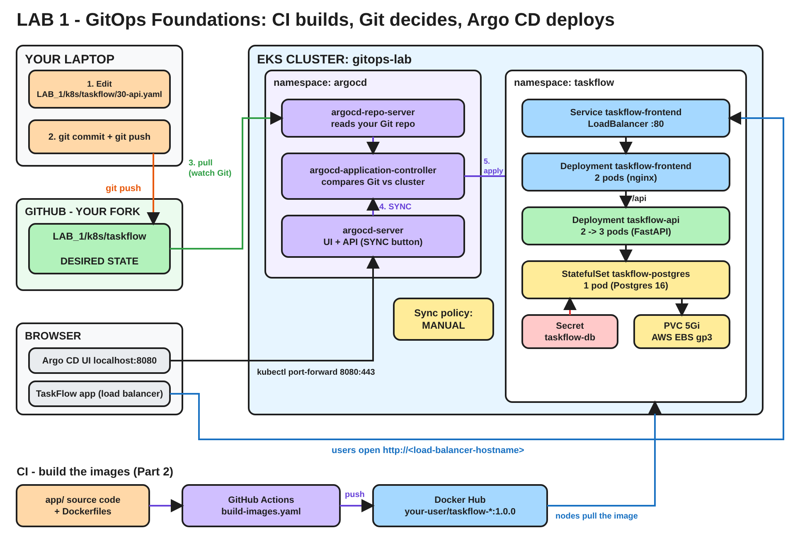

# Lab 1 - GitOps Foundations

**Argo CD GitOps Mega Lab | Lab 1 of 7**
**Written by Rahul Chaubey**

---

## Before we touch anything, one question

It is Monday morning. A developer fixes a small bug and pushes the change. Twenty minutes later the fix is running in production.

Nobody opened a terminal on the production cluster. Nobody ran kubectl. Nobody even has the kubeconfig for production.

So how did the change get there?

Hold on to that question. By the end of this lab you will have built exactly that path yourself, end to end, and you will be able to answer it in one sentence.

---

## A note from me

Hello, and welcome to Lab 1.

I have written this runbook so you can repeat everything we did in class on your own. I will not just give you commands. Before every step I will tell you why we need it, and sometimes I will ask you a question first. Try to answer it in your head before you read on. That small pause is where the real learning happens.

You finished Lab 0, so you have a working EKS cluster. In this lab you will:

1. Build the application's container images yourself, with a CI pipeline
2. Tell Git which image version should run
3. Install Argo CD
4. Let Argo CD deploy the application from Git
5. Change the running application with nothing but a Git commit

---

## Architecture of this lab



The editable diagram is in the `diagrams` folder at the top of the repository, as `lab-1-architecture.excalidraw`. To open it, go to https://excalidraw.com, click the menu, choose **Open**, and select the file.

**Time needed:** about 90 minutes

---

## Part 0 - Starting point

**Get the latest labs into your fork.** I add new lab folders as the course goes on. Open your fork on GitHub and click **Sync fork**, then **Update branch**. Then pull it to your laptop:

```bash
cd argocd-gitops-mega-lab
git pull origin main
cd LAB_1
```

From now on, run every command in this lab from inside the `LAB_1` folder.

Quick check:

```bash
kubectl get nodes
kubectl get storageclass
git remote -v
```

**Checkpoint:** 2 nodes `Ready`, `gp3 (default)` is listed, and the Git remote URLs contain your GitHub username.

If any check fails, go back to Lab 0 and fix it first.

---

## Part 1 - Meet TaskFlow, the app we will deploy

We need something real to deploy. Not a single nginx pod, because that teaches you nothing about real deployments. So I wrote a small application called **TaskFlow**. It is a simple to-do list, but it is built like a real product:

| Tier | Technology | What it does |
|---|---|---|
| Frontend | nginx | Serves the web page and forwards /api calls to the API |
| API | Python FastAPI | Saves and lists tasks, reports its version and pod name |
| Database | Postgres | Keeps your tasks on a persistent disk |

Open the `app` folder at the top of the repository and look around. You will find the Python code, the web page, and a `Dockerfile` for the API and the frontend.

**Think about it:** You have the code. You have a Kubernetes cluster. Can Kubernetes run `app/api/main.py` directly?

**Answer:** No. Kubernetes never runs source code. It only runs container images that it pulls from a registry. Somebody has to turn this code into images and put them somewhere Kubernetes can reach.

So before we can talk about deploying anything, we have a more basic question.

**Who builds the image?**

---

## Part 2 - CI: build the images yourself

In a real company, nobody builds production images on their laptop. A **CI pipeline** does it. Every time the code changes, the pipeline builds the image and pushes it to a registry such as Docker Hub.

Your repository already has that pipeline. Open `.github/workflows/build-images.yaml` (from the top of the repository) and read it. It has only four steps:

1. Get the source code
2. Set up Docker Buildx
3. Log in to Docker Hub
4. Build the image and push it

**Think about it:** Step 3 logs in to Docker Hub. Whose Docker Hub account? And where does the password come from? It is definitely not written in this file.

**Answer:** Your account, and the password comes from **GitHub secrets**. You store the secret once in your repository settings. GitHub hands it to the pipeline at run time and hides it in every log. The password never appears in your code.

Let us set that up.

### Step 1 - Create a Docker Hub access token

We do not give the pipeline your real Docker Hub password. We give it a token: a separate key that you can revoke at any time without changing your password.

1. Log in to https://hub.docker.com
2. Click your profile picture, then **Account settings**, then **Personal access tokens**, then **Generate new token**.
3. Description: `github-actions-gitops-lab`. Access permissions: **Read & Write**.
4. Click **Generate** and copy the token. You will see it only once.

### Step 2 - Store it as GitHub secrets

1. Open your fork on GitHub.
2. Go to **Settings**, then **Secrets and variables**, then **Actions**.
3. Stay on the **Secrets** tab and click **New repository secret** twice:

| Name | Secret |
|---|---|
| DOCKERHUB_USERNAME | your Docker Hub username |
| DOCKERHUB_TOKEN | the token you just copied |

Type the names exactly as shown. The pipeline looks them up by these names.

**Concept: Secrets are never copied to forks**
You forked my repository, but my secrets did not come with it. GitHub never copies secrets to a fork. If it did, anyone could fork a repository and steal its passwords. That is why every student adds their own.

### Step 3 - Turn on Actions in your fork

Open the **Actions** tab of your fork. GitHub switches off workflows in new forks for safety, so you will see a message saying workflows are not being run on this forked repository. Click **I understand my workflows, go ahead and enable them**.

### Step 4 - Run the pipeline

1. In the left menu, click **Build TaskFlow images**.
2. Click **Run workflow**, keep the branch `main` and the version `1.0.0`, and click the green **Run workflow** button.
3. Refresh the page. You will see two jobs running side by side: `build (api)` and `build (frontend)`.

While it runs (about 2 to 4 minutes), click into a job and watch the log. You will recognise every line from your Docker classes: the base image is pulled, pip installs the libraries, the layers are built, and the image is pushed.

**Checkpoint:** both jobs show a green tick. On Docker Hub you now have two new repositories: `taskflow-api` and `taskflow-frontend`, each with tag `1.0.0`.

Open each repository on Docker Hub and make sure it is **Public**. If it is private, your cluster cannot pull it without a password.

**Concept: Where CI stops**
Look at what the pipeline did not do. It did not touch your cluster. It has no kubeconfig and no AWS keys. Its job ends the moment the image is in the registry. Keep this in mind, because it is the key to the whole course.

---

## Part 3 - Tell Git which image to run

Open `k8s/taskflow/30-api.yaml` and find this line:

```yaml
image: discoverdevops/taskflow-api:1.0.0
```

**Think about it:** Whose image is that?

**Answer:** Mine. `discoverdevops` is my Docker Hub account. You just built your own images, so let us point the files at yours.

Run this from the LAB_1 folder. It updates the image names in every lab folder in one go:

```bash
export DH_USER=<your-dockerhub-username>
sed -i "s#discoverdevops/taskflow#$DH_USER/taskflow#g" ../LAB_*/k8s/taskflow/*.yaml
grep -rn "image:" ../LAB_*/k8s/taskflow/
```

On macOS use `sed -i ''` instead of `sed -i`.

**Checkpoint:** every `taskflow-api` and `taskflow-frontend` image line now starts with your Docker Hub username. The `postgres:16-alpine` line stays as it is, because that is the official Postgres image.

Commit and push:

```bash
git add ../LAB_*/k8s/taskflow/
git commit -m "lab1: use my own TaskFlow images"
git push origin main
```

When you sync new labs into your fork later, run the same `sed` command again so the new lab folders also use your images.

**Concept: The image line is the handshake between CI and CD**
CI produced an image and stopped. Now Git holds one line that says which image, and which version, should be running. That line is the only connection between the build side and the deploy side. To release a new version, you do not touch the cluster. You change this line in Git.

---

## Part 4 - Who deploys it?

The images are on Docker Hub. Git says which ones to run. Something still has to make the cluster match Git.

**Think about it:** The obvious answer is "add a deploy step at the end of the pipeline that runs `kubectl apply`". It works. So what is the problem with it?

**Answer:** To run `kubectl apply`, the pipeline needs the cluster's credentials. Now your GitHub repository, every pipeline run, and anyone who can edit the workflow file holds the keys to production. And once the pipeline finishes, nobody is watching the cluster anymore. If someone changes it by hand, the pipeline will never know.

GitOps flips the direction. Instead of the pipeline pushing into the cluster, a tool inside the cluster pulls from Git and keeps the cluster matching Git, all the time. That tool is Argo CD.

```text
 Push model (old)                         Pull model (GitOps)

 Pipeline --kubectl apply--> Cluster      Git <--watches-- Argo CD (inside the cluster)
 (pipeline holds cluster keys)                              applies changes itself
                                          (cluster keys never leave the cluster)
```

Now let us install it.

```bash
kubectl create namespace argocd
kubectl apply -n argocd --server-side --force-conflicts \
  -f https://raw.githubusercontent.com/argoproj/argo-cd/stable/manifests/install.yaml
```

Why `--server-side`? Some Argo CD resource definitions are too large for a normal `kubectl apply`, which fails with an "annotations too long" error. Server-side apply does not have that limit.

Wait for everything to start:

```bash
kubectl wait --for=condition=Available deployment --all -n argocd --timeout=300s
kubectl get pods -n argocd
```

**Checkpoint:** all pods are `Running`.

You do not need to memorise every pod. Three of them matter today:

| Pod | Its job, in one line |
|---|---|
| argocd-repo-server | Reads your Git repository |
| argocd-application-controller | Compares Git with the cluster and fixes the difference |
| argocd-server | The UI and API you will log in to |

The others are for later labs (applicationset-controller in Lab 6) or features we do not use here (dex for single sign-on, notifications for alerts).

---

## Part 5 - Log in to the Argo CD UI

Open a second terminal and keep this running:

```bash
kubectl port-forward svc/argocd-server -n argocd 8080:443
```

In your first terminal, get the initial admin password:

```bash
kubectl -n argocd get secret argocd-initial-admin-secret \
  -o jsonpath="{.data.password}" | base64 -d; echo
```

Open https://localhost:8080 and accept the certificate warning. Log in as `admin` with that password.

**Checkpoint:** an empty Applications page.

---

## Part 6 - Your first Application

An Argo CD **Application** is just a pointer. It says: this Git repository, this branch, this folder, should be running in this cluster and this namespace.

Click **+ NEW APP** and fill in:

| Field | Value |
|---|---|
| Application Name | taskflow |
| Project | default |
| Sync Policy | Manual |
| Repository URL | https://github.com/your-github-username/argocd-gitops-mega-lab.git |
| Revision | main |
| Path | LAB_1/k8s/taskflow |
| Cluster URL | https://kubernetes.default.svc |
| Namespace | taskflow |

Click **CREATE**.

The application shows **OutOfSync** and **Missing**.

**Think about it:** Nothing failed, and nothing was deployed. So why does Argo CD call it OutOfSync?

**Answer:** Argo CD has read your Git folder and knows what should exist. It has looked at the cluster and found none of it. Git and the cluster disagree, and that is exactly what OutOfSync means.

**Concept: Desired state vs live state**
Argo CD always compares two things. The desired state is what Git says. The live state is what is actually running. Everything Argo CD does comes from comparing these two. With Manual sync, it shows you the difference and waits for your approval.

Click **APP DIFF** to see exactly what will be created. Then click **SYNC**, then **SYNCHRONIZE**.

Watch the resource tree build itself: Namespace, Secret, StatefulSet, Deployments, Services, Pods.

---

## Part 7 - See TaskFlow running

```bash
kubectl get all -n taskflow
kubectl get pvc -n taskflow
```

**Checkpoint:**

- `taskflow-postgres-0` is `Running` and its PVC is `Bound`
- 2 `taskflow-api` pods are `Running` and show `READY 1/1`
- 2 `taskflow-frontend` pods are `Running`

Check that the pods are running your images:

```bash
kubectl get pods -n taskflow -o jsonpath='{range .items[*]}{.spec.containers[0].image}{"\n"}{end}'
```

You will see your Docker Hub username. The image you built in Part 2 is now running in your cluster, and you never ran `kubectl apply` on it.

**Concept: Readiness probe**
The API shows `READY 1/1` only after its `/readyz` check can reach Postgres. Until then, Kubernetes sends it no traffic. That is how real applications avoid serving errors while they start.

Get the application URL. The load balancer takes 2 to 3 minutes to come up:

```bash
kubectl get svc taskflow-frontend -n taskflow \
  -o jsonpath='{.status.loadBalancer.ingress[0].hostname}'; echo
```

Open `http://<that-hostname>` and add a few tasks. Look at the banner at the top. It shows a message, a version, and the pod that answered you. Remember it, because you are about to change it.

---

## Part 8 - Change production with a Git commit

This is the moment the whole lab has been building towards.

Open `k8s/taskflow/30-api.yaml` and make three changes:

```yaml
spec:
  replicas: 3                     # was 2
  ...
          env:
            - name: APP_VERSION
              value: "1.1.0"      # was 1.0.0
            - name: APP_MESSAGE
              value: "Changed through Git - no kubectl!"
```

Commit and push:

```bash
git add k8s/taskflow/30-api.yaml
git commit -m "lab1: scale api to 3 and change banner message"
git push origin main
```

In the Argo CD UI:

1. Click **REFRESH**. (Argo CD checks Git every 3 minutes on its own. Refresh checks now.)
2. The app turns **OutOfSync**. Click **APP DIFF** and you will see exactly your three changes.
3. Click **SYNC**, then **SYNCHRONIZE**.
4. Watch the rolling update. New pods come up before old pods go away.

```bash
kubectl get pods -n taskflow -l app.kubernetes.io/name=taskflow-api
```

**Checkpoint:** 3 API pods. Reload the browser a few times. The new message appears, and the pod name changes as requests spread across the 3 pods. Your tasks are still there, because they live in Postgres and not in the API pods.

Now go back to the question from the start of this lab. How did the change reach production without anyone running kubectl?

You just answered it yourself: **the developer changed Git, and a tool inside the cluster made the cluster match Git.** Congratulations. That one sentence is GitOps, and the rest of this course is about making it safer, more automatic, and bigger.

**Concept: Zero-downtime rolling update**
Look at the `strategy` section in `30-api.yaml`. With `maxUnavailable: 0`, Kubernetes never removes an old pod until a new one is ready. Users never see the app go down during a release.

---

## Part 9 - Who changed what, and when?

**Think about it:** Your manager asks, "What changed in production last Tuesday, and who did it?" Without GitOps, where would you look?

Probably in someone's terminal history, or a chat message, or nowhere at all.

With GitOps, open **HISTORY AND ROLLBACK** in Argo CD. Every sync is recorded against a Git commit. Then:

```bash
git log --oneline -5
```

**Concept: Deployment history is Git history**
Every change to production is a commit, with an author, a time and a message. You get a complete audit trail without doing anything extra.

---

## Part 10 - The same Application, written as code

You created the Application by clicking. That is fine for learning, but clicks cannot be reviewed, copied or rebuilt.

Open `argocd/taskflow-app.yaml`. It is exactly the Application you just clicked together, as a YAML file. Compare it with what Argo CD stored:

```bash
kubectl get application taskflow -n argocd -o yaml | head -40
```

**Concept: Applications are code too**
From Lab 2 onwards we manage Applications as YAML in Git. That is what will let us rebuild an entire cluster with one command in Lab 3.

---

## Summary - What you can now explain

| Question | Your answer |
|---|---|
| Who builds the image? | The CI pipeline (GitHub Actions), which pushes it to Docker Hub |
| Does CI touch the cluster? | No. It stops at the registry |
| How does the cluster know which image to run? | The `image:` line in Git |
| Who applies changes to the cluster? | Argo CD, from inside the cluster |
| What does OutOfSync mean? | Git and the cluster disagree |
| How do you release a change? | A Git commit, then a sync |
| Where is the deployment history? | Git log and Argo CD history |

```text
 CI                                   GIT                        CD
 app/ code --> GitHub Actions -->     image: line in YAML  <--   Argo CD --> EKS
               Docker Hub image       (desired state)            (pulls and applies)
```

---

## Did you spot the problem?

Open `k8s/taskflow/10-postgres-secret.yaml` and run:

```bash
echo VGFza0Zsb3dAMTIz | base64 -d; echo
```

You just read the database password straight out of Git. Base64 is encoding, not encryption.

**Think about it:** You just learned that secrets belong in GitHub secrets, not in code. So why is this one sitting in Git?

I left it there on purpose. GitOps says everything lives in Git, but passwords must not. We will solve that contradiction properly in Lab 5 with Sealed Secrets.

---

## Before the next lab

If Lab 2 is coming up soon, **keep your cluster running**. Lab 2 continues from exactly here.

If not, delete everything to stop AWS charges:

```bash
kubectl delete application taskflow -n argocd
kubectl delete namespace taskflow
eksctl delete cluster -f ../LAB_0/cluster/eks-cluster.yaml
```

Delete the `taskflow` namespace before the cluster. That removes the AWS load balancer and the EBS disk cleanly.

---

## Troubleshooting

| What you see | Cause and fix |
|---|---|
| Workflow fails at "Log in to Docker Hub" | Secret names are wrong, or the token was copied incompletely. Check DOCKERHUB_USERNAME and DOCKERHUB_TOKEN |
| Workflow fails at push with "denied" | The token has Read only access. Create a new one with Read & Write |
| No "Run workflow" button | Actions are not enabled in your fork. Open the Actions tab and enable them |
| ImagePullBackOff | The image name does not match Docker Hub, or the Docker Hub repository is private. Check the `image:` lines and make the repositories Public |
| taskflow-postgres-0 stuck in Pending | The disk was not created. Check that `kubectl get sc` shows gp3 (default) |
| API pods Running but 0/1 READY | Postgres is not ready yet. Wait a minute, then check `kubectl logs deploy/taskflow-api -n taskflow` |
| Argo CD says repository not found | Typo in the repository URL, or your fork is private |
| App stays OutOfSync after push | Click REFRESH and confirm you pushed to main |
| Browser cannot open the app | The load balancer is still being created. Wait 3 minutes |

---

## Keep learning with me

If this lab helped you, there is a lot more where it came from.

| Where | Link |
|---|---|
| YouTube - Build Automate Architect | https://www.youtube.com/@BuildAutomateArchitect |
| System Design playlist | https://www.youtube.com/playlist?list=PLeAHTLMwFYQ0 |
| Telegram channel (lab updates and notes) | https://t.me/BuildAutomateArchitect |
| Website | https://rahulchaubeyconsulting.com/ |

Subscribe on YouTube and join the Telegram channel so you do not miss the next lab.

See you in Lab 2, where we break the cluster on purpose and watch Argo CD heal it.

**Rahul Chaubey**
