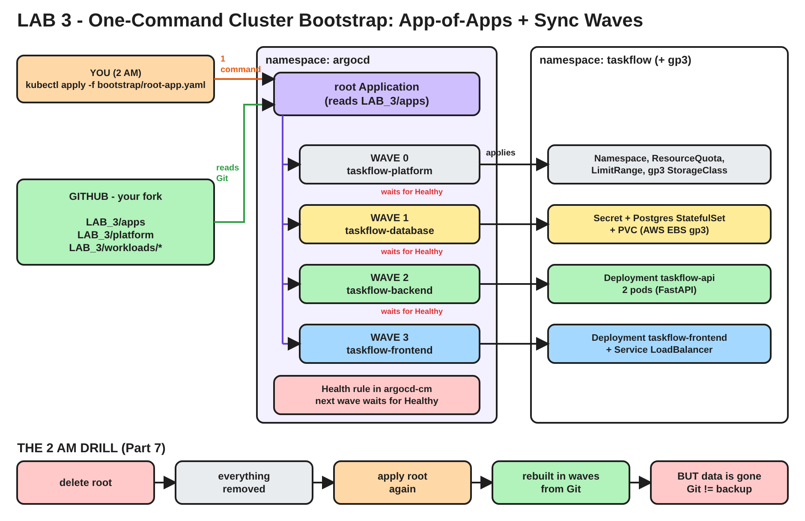

# Lab 3 - One-Command Cluster Bootstrap

**Argo CD GitOps Mega Lab | Lab 3 of 7**
**Written by Rahul Chaubey**

---

## Before we touch anything, one question

It is 2 AM. Your production cluster is gone. Maybe someone deleted it by mistake, maybe the region had an outage. The good news: your Git repository is perfectly fine.

Your manager calls and asks one question: **"How long until we are back?"**

Think about everything you did by hand in Lab 0, Lab 1 and Lab 2 to get TaskFlow running. Count the steps. Create a storage class. Install Argo CD. Click through a form to create an Application. Remember the right path, the right namespace, the right sync settings. Do it in the right order.

Now imagine doing all of that at 2 AM, under pressure, for not one app but forty.

By the end of this lab, the answer to your manager will be: **"One command, and about ten minutes."**

---

## A note from me

Welcome to Lab 3.

So far, one Argo CD Application deployed everything in one go: the database, the API and the frontend, all from one folder. That was perfect for learning, but it does not survive contact with a real company. In this lab we split the system into layers, make them come up in the right order, and then bootstrap the whole thing from a single file.

As always, try to answer every **Think about it** question in your head before you read the answer.

In this lab you will:

1. Start from a clean namespace
2. Understand why one big Application is not enough
3. Learn the App-of-Apps pattern
4. Use sync waves to control the order
5. Bootstrap everything with one command
6. See a guardrail stop a bad change
7. Destroy everything and rebuild it from Git

---

## Architecture of this lab



The editable diagram is in the `diagrams` folder at the top of the repository, as `lab-3-architecture.excalidraw`. To open it, go to https://excalidraw.com, click the menu, choose **Open**, and select the file.

**Time needed:** about 75 minutes

---

## Part 0 - Starting point

**Get the latest labs into your fork.** Open your fork on GitHub and click **Sync fork**, then **Update branch**. Then:

```bash
cd argocd-gitops-mega-lab
git pull origin main
cd LAB_3
```

From now on, run every command in this lab from inside the `LAB_3` folder.

You need your EKS cluster with Argo CD installed:

```bash
kubectl get nodes
kubectl get pods -n argocd
```

**Checkpoint:** 2 nodes `Ready`, and all Argo CD pods `Running`.

If you deleted your cluster after Lab 2, create it again with Lab 0 Parts 4 and 5, then install Argo CD with Lab 1 Part 4.

Keep the Argo CD UI open in a second terminal:

```bash
kubectl port-forward svc/argocd-server -n argocd 8080:443
```

### Put your own names into the LAB_3 files

The files in this folder point at my GitHub and my Docker Hub. Point them at yours:

```bash
export GH_USER=<your-github-username>
export DH_USER=<your-dockerhub-username>
sed -i "s#<YOUR_GITHUB_USER>#$GH_USER#g" bootstrap/root-app.yaml apps/*.yaml
sed -i "s#discoverdevops/taskflow#$DH_USER/taskflow#g" workloads/*/*.yaml
grep -rn "repoURL\|image:" bootstrap apps workloads
```

On macOS use `sed -i ''` instead of `sed -i`.

**Checkpoint:** every `repoURL` contains your GitHub username, and the taskflow images use your Docker Hub username.

Push it, because Argo CD reads Git, not your laptop:

```bash
git add .
git commit -m "lab3: point LAB_3 at my repo and my images"
git push origin main
```

---

## Part 1 - Clear the stage

The `taskflow` Application from Lab 2 is still running. In this lab, new Applications will take over the same resources, so the old one has to go first.

**Think about it:** In Lab 2 you added the resources finalizer to this Application. So what will happen to the database when you delete the Application?

**Answer:** The finalizer tells Argo CD to delete everything the Application deployed. The database goes too, and so do your tasks. That is fine here, because we are about to rebuild everything from Git.

```bash
kubectl delete application taskflow -n argocd
kubectl delete namespace taskflow --ignore-not-found
kubectl get all -n taskflow
```

The second command is a safety net in case you skipped the finalizer in Lab 2.

**Checkpoint:** `No resources found in taskflow namespace.` The Applications page in the Argo CD UI is empty.

Argo CD is still running, but your application is gone. For our purposes, this is the empty cluster from the 2 AM story.

---

## Part 2 - Why one big Application is not enough

**Think about it:** In Lab 1 and Lab 2, a single Application deployed the database, the API, the frontend and the namespace, all at the same moment. Name one real problem with that in a company with several teams.

There are several good answers:

- **Order.** Everything starts at once. The API comes up before Postgres is ready and fails its readiness check. The frontend opens a public load balancer before there is anything healthy behind it.
- **Ownership.** The platform team owns the namespace, quotas and storage. The database team owns Postgres. App teams own their services. One Application means one owner for everything.
- **Blast radius.** A small change to the frontend makes Argo CD compare and sync the whole stack, including the database.

So we split the system into layers.

Look at the LAB_3 folder:

```text
LAB_3/
  bootstrap/
    root-app.yaml                 the ONE file you apply by hand
  apps/                           Argo CD Applications (not Kubernetes workloads!)
    00-platform.yaml              wave 0
    10-database.yaml              wave 1
    20-backend.yaml               wave 2
    30-frontend.yaml              wave 3
  platform/                       namespace, quota, limits, storage class
  workloads/
    database/                     Postgres and its secret
    backend/                      the API
    frontend/                     nginx and the load balancer
```

Open `apps/10-database.yaml`. It is not a Deployment or a StatefulSet. It is an Argo CD **Application** that points at the `workloads/database` folder.

**Concept: App-of-Apps**
The `root` Application points at the `apps` folder. That folder does not contain Kubernetes workloads. It contains more Applications. So Argo CD deploys the root, the root deploys four child Applications, and each child deploys its own real Kubernetes resources.

```text
 root  (bootstrap/root-app.yaml)
   |
   +-- taskflow-platform   -> platform/            namespace, quota, limits, gp3
   +-- taskflow-database   -> workloads/database/  secret, Postgres
   +-- taskflow-backend    -> workloads/backend/   API
   +-- taskflow-frontend   -> workloads/frontend/  nginx, load balancer
```

One Application to rule them all. Adding a new service later means adding one small file to `apps`. Nobody has to click anything.

---

## Part 3 - Control the order with sync waves

Open any file in `apps/` and find this annotation:

```yaml
  annotations:
    argocd.argoproj.io/sync-wave: "1"
```

| Wave | Application | Why at this point |
|---|---|---|
| 0 | taskflow-platform | Everything lives inside the namespace and needs the storage class |
| 1 | taskflow-database | The API cannot work without Postgres |
| 2 | taskflow-backend | The frontend sends every /api call here |
| 3 | taskflow-frontend | Opens the public door to users, so it comes last |

**Concept: Sync waves**
Argo CD applies resources in wave order, lowest number first. It finishes one wave before it starts the next. Resources without the annotation are in wave 0. You can use any numbers, even negative ones. Leaving gaps (0, 10, 20) makes it easy to slot something in later.

**Think about it:** A wave number is just a label. How does Argo CD know that wave 1 is "finished" and wave 2 may start?

**Answer:** It waits until everything in the wave is **Healthy**. And that leads to a surprise.

---

## Part 4 - Teach Argo CD to wait

Here is something many engineers learn the hard way.

Since Argo CD version 1.8, when one Application manages other Applications, it does **not** look at their health. It creates the child Application objects and immediately moves on. Your waves would fire one after another within seconds, and the ordering would be useless.

The fix is a small health rule that tells Argo CD: "an Application is healthy only when the Application itself reports Healthy". Read it:

```bash
cat bootstrap/argocd-cm-app-health.yaml
```

Apply it to the Argo CD settings, then restart the controller so it picks up the rule:

```bash
kubectl patch configmap argocd-cm -n argocd --patch-file bootstrap/argocd-cm-app-health.yaml
kubectl rollout restart statefulset argocd-application-controller -n argocd
kubectl rollout status statefulset argocd-application-controller -n argocd
```

**Checkpoint:** `partitioned roll out complete` or `statefulset rolling update complete`.

**Concept: Argo CD's own settings are configuration too**
In a fully GitOps setup, even this ConfigMap lives in Git and Argo CD manages its own installation. We apply it by hand here to keep the lab focused, and we will come back to it in the capstone lab.

---

## Part 5 - The one command

Open the Argo CD UI so you can watch. In your terminal, start a live view of the Applications:

```bash
kubectl get applications -n argocd -w
```

Open a **third** terminal, go to the LAB_3 folder, and run the one command:

```bash
kubectl apply -f bootstrap/root-app.yaml
```

Now watch, without touching anything:

1. `root` appears.
2. `taskflow-platform` appears and becomes Synced and Healthy.
3. Only then does `taskflow-database` appear. It stays Progressing while Postgres starts and its disk is created.
4. When the database is Healthy, `taskflow-backend` appears.
5. Last, `taskflow-frontend` appears and waits for its AWS load balancer.

The whole thing takes about 5 to 8 minutes. Most of that is the EBS disk and the load balancer.

Press Ctrl+C to stop the watch, then check:

```bash
kubectl get applications -n argocd
kubectl get all -n taskflow
```

**Checkpoint:** five Applications, all `Synced` and `Healthy`. Postgres, 2 API pods and 2 frontend pods all `Running`.

In the UI, click the `root` Application. You see the four children as boxes. Click into any child to see its own Kubernetes resources.

Open the app in your browser:

```bash
kubectl get svc taskflow-frontend -n taskflow \
  -o jsonpath='{.status.loadBalancer.ingress[0].hostname}'; echo
```

The banner shows version 1.3.0, exactly where Lab 2 ended.

**Concept: The root Application is the only manual step**
Look at what you typed: one `kubectl apply`. Everything else came from Git, in the right order. This is called **bootstrapping**. Real platform teams bootstrap new clusters exactly like this.

---

## Part 6 - A guardrail stops a bad change

The platform wave did more than create a namespace. Look at what it put in place:

```bash
kubectl describe resourcequota taskflow-quota -n taskflow
kubectl describe limitrange taskflow-defaults -n taskflow
```

**Think about it:** A developer makes a typo and sets the API to `replicas: 30` instead of `3`. Without any guardrail, what happens to the cluster?

**Answer:** Kubernetes tries to run 30 API pods. They eat the CPU and memory on your nodes, and other applications start failing. One typo takes down a shared cluster.

Let us make that typo on purpose. Edit `workloads/backend/30-api.yaml` and set:

```yaml
  replicas: 30
```

```bash
git add workloads/backend/30-api.yaml
git commit -m "oops: 30 replicas"
git push origin main
```

Click **REFRESH** on `taskflow-backend` in the UI. Then:

```bash
kubectl get pods -n taskflow -l app.kubernetes.io/name=taskflow-api
kubectl get events -n taskflow --field-selector reason=FailedCreate | tail -5
kubectl describe resourcequota taskflow-quota -n taskflow
```

**Checkpoint:** some extra API pods are created, but the events show `exceeded quota`, and the quota shows memory or CPU requests at the limit. The namespace stopped growing. The rest of the cluster is safe.

Notice something else: only `taskflow-backend` changed. The platform, database and frontend Applications were not touched. That is the blast radius from Part 2, now kept small.

Now roll back the way real teams do, with Git:

```bash
git revert --no-edit HEAD
git push origin main
```

Click **REFRESH** on `taskflow-backend`.

**Checkpoint:** back to 2 API pods.

**Concept: git revert is your rollback button**
`git revert` creates a new commit that undoes the bad one. The history keeps both: the mistake and the fix. Argo CD simply deploys whatever Git now says.

---

## Part 7 - The 2 AM drill

Time to answer the question from the start of this lab. We will destroy the whole application and rebuild it from Git.

First, add a few tasks in the browser so you have some data.

Now delete the root Application. Because every Application in this lab has the resources finalizer, this cascades all the way down: root deletes the four children, and each child deletes its own resources.

```bash
kubectl delete application root -n argocd
kubectl get applications -n argocd
kubectl get all -n taskflow
```

**Checkpoint:** no Applications, and the taskflow namespace is gone or empty.

Now the moment of truth. Note the time, and run the one command again:

```bash
date
kubectl apply -f bootstrap/root-app.yaml
kubectl get applications -n argocd -w
```

Watch the waves come back: platform, database, backend, frontend. When all five are Synced and Healthy, press Ctrl+C and run `date` again.

**Checkpoint:** the whole application is back, in the right order, from one command. Write down how many minutes it took. That is your answer for the manager.

Now open the app in the browser. The load balancer has a new hostname, so get it again with the command from Part 5.

**Think about it:** The app is back, but your tasks are gone. Why? And what does that tell you about what Git can and cannot back up?

**Answer:** Git holds the **desired state**: every Deployment, Service, setting and image version. It does not hold **data**. The tasks lived on the EBS disk, and that disk was deleted with the namespace. Git rebuilds the house. It does not bring back the furniture. Real teams back up data separately, with database dumps, EBS snapshots, or tools like Velero.

**Concept: Git is your infrastructure backup**
Every piece of configuration you need to rebuild this application is in Git. If a cluster dies, you create a new one, install Argo CD, and apply one root file. Data needs its own backup plan.

---

## Summary - What you can now explain

| Question | Your answer |
|---|---|
| What is App-of-Apps? | An Application whose manifests are other Applications |
| What does the root Application point at? | A folder of Application files, not workloads |
| How do you control the order? | The `argocd.argoproj.io/sync-wave` annotation |
| How does Argo CD know a wave is done? | It waits for Healthy, once the Application health rule is in place |
| How many manual steps to rebuild the app? | One `kubectl apply` of the root file |
| What does the platform wave protect against? | Runaway resource usage, through ResourceQuota and LimitRange |
| How do you roll back a bad change? | `git revert`, then Argo CD syncs |
| What does Git NOT back up? | Data, such as the Postgres disk |

```text
 kubectl apply -f root-app.yaml
          |
        root  ---> wave 0  platform    (namespace, quota, limits, gp3)
                   wave 1  database    (secret, Postgres)
                   wave 2  backend     (API)
                   wave 3  frontend    (nginx, load balancer)
```

---

## Did you notice?

In Part 6 you set `replicas` in Git and Argo CD enforced it exactly. That is what we want, most of the time.

**Think about it:** What happens when a Horizontal Pod Autoscaler wants 5 replicas because traffic is high, but Git says 2, and self-heal is on?

They will fight each other. In Lab 4 we create exactly that fight on purpose, and then end it properly.

---

## Before the next lab

If Lab 4 is coming up soon, **keep your cluster running**.

If not, clean up to stop AWS charges. Deleting the root Application removes everything, as you saw in Part 7:

```bash
kubectl delete application root -n argocd
kubectl get all -n taskflow
eksctl delete cluster -f ../LAB_0/cluster/eks-cluster.yaml
```

Wait until `kubectl get all -n taskflow` shows nothing before deleting the cluster. That confirms the load balancer and the EBS disk are gone.

---

## Troubleshooting

| What you see | Cause and fix |
|---|---|
| root shows "repository not found" | The `repoURL` still has the placeholder or a typo. Check `grep repoURL bootstrap/*.yaml apps/*.yaml`, fix, commit and push |
| root is Synced but no children appear | You did not push after the sed in Part 0. Argo CD reads Git, not your laptop. Run `git push origin main` |
| All children appear at the same time | The health rule from Part 4 is missing. Apply it, restart the controller, then delete and re-apply root |
| taskflow-database stuck in Progressing | Postgres is waiting for its disk. Check `kubectl get pvc -n taskflow` and that gp3 is the default storage class |
| ImagePullBackOff | The taskflow image names do not match your Docker Hub, or the Docker Hub repositories are private |
| "shared resource" warning | The old `taskflow` Application from Lab 2 still exists. Do Part 1 again |
| Deleting root takes a long time | The finalizers are waiting for the load balancer and disk to be removed. Give it a few minutes |
| kubectl patch says unknown flag --patch-file | Your kubectl is very old. Update kubectl to a recent version |

---

## Keep learning with me

If this lab helped you, there is a lot more where it came from.

| Where | Link |
|---|---|
| YouTube - Build Automate Architect | https://www.youtube.com/@BuildAutomateArchitect |
| System Design playlist | https://www.youtube.com/playlist?list=PLeAHTLMwFYQ0 |
| Telegram channel (lab updates and notes) | https://t.me/BuildAutomateArchitect |
| Website | https://rahulchaubeyconsulting.com/ |

Subscribe on YouTube and join the Telegram channel so you do not miss the next lab.

See you in Lab 4, where Argo CD and the autoscaler go to war.

**Rahul Chaubey**
